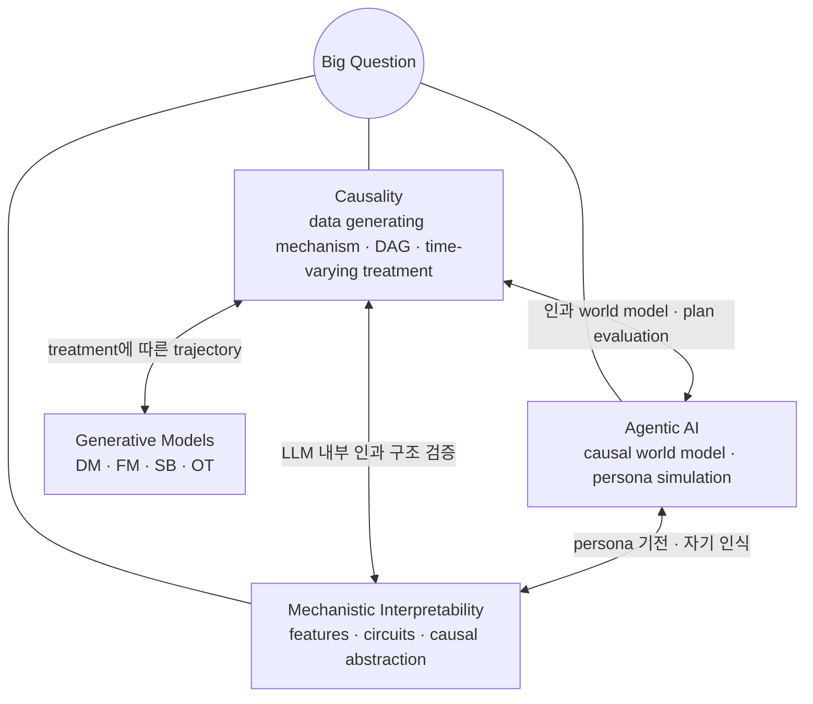

# research-hub

논문, 강의, 영상, 블로그 글을 읽고 남긴 기록을 모아 **새로운 연구 주제를 발굴하고 논문을 쓰기 위한** 개인 연구 아카이브입니다.
Claude가 이 저장소를 읽고 정리하며, 연구 방향을 함께 토론합니다. 에이전트 규칙은 [CLAUDE.md](CLAUDE.md)에 있습니다.

## Big Question

> Agent/LLM은 관측 데이터 이면의 **data generating mechanism**을 추론하는가?
> 그렇지 않다면 그렇게 만들 수 있는가? 그리고 그것을 어떻게 검증하는가?



## 주제
| 주제 | 핵심 | 바로가기 |
|---|---|---|
| Causality | 인과추론 = data generating mechanism 추론. LLM/Agent 기반 인과추론 | [topics/causality](topics/causality/README.md) |
| Agentic AI | Causally aware agent, 멀티 에이전트 사회, persona simulation | [topics/agentic-ai](topics/agentic-ai/README.md) |
| Mechanistic Interpretability | MI = LLM이 인과 구조로 추론하는지 검증하는 도구 | [topics/mech-interp](topics/mech-interp/README.md) |
| Generative Models | 확률 질량을 어떻게 옮길 것인가. SB 안에서 본 DM과 FM | [topics/generative-models](topics/generative-models/README.md) |
| Background | LLM 기초, 수학, 불확실성 | [background](background/README.md) |

## 지금 보면 좋은 것
- 📌 **연구 아이디어 11개:** [ideas/](ideas/README.md)
- 💬 **최신 토론:** [discussions/2026-W48.md](discussions/2026-W48.md) — 질문 3개에 답을 달아 주세요
- 🗂️ **기존 블로그 이전 현황:** [migration/tistory-index.md](migration/tistory-index.md)

## 사용법

### 기록하기
| 하고 싶은 것 | 방법 |
|---|---|
| 일단 링크만 던져두기 | `inbox/README.md`에 한 줄 추가 |
| 논문 노트 | `templates/paper.md` 복사 → `topics/<주제>/papers/YYYY-짧은이름.md` |
| 내 생각 | `templates/thought.md` 복사 → `topics/<주제>/thoughts/YYYY-MM-DD-짧은이름.md` |
| 연구 아이디어 | `templates/idea.md` 복사 → `ideas/I##-짧은이름.md` |
| 토론에 답하기 | `discussions/`의 최신 파일 맨 아래 "연구자 답변"에 쓰기 |

**"나의 리뷰"와 "나의 생각"은 본인만 씁니다.** Claude는 "에이전트 노트"에만 씁니다.

### Claude에게 요청하기
- `업데이트해줘` — inbox 정리, 주제 README 갱신, 관련 연구 찾기, 이번 주 토론 작성 ([절차](CLAUDE.md#7-업데이트-절차-업데이트해줘-요청-시))
- `causality만 업데이트해줘` / `inbox만 정리해줘` — 범위 지정
- `I02에 대해 토론하자` — 특정 아이디어 토론
- `이 논문 노트 만들어줘: <링크>` — 논문 노트 초안 (요약과 에이전트 노트만, 리뷰는 비워 둠)

## 구조
```
inbox/  topics/<주제>/{papers,thoughts,concepts,lectures,videos,posts}/  background/
ideas/  projects/  discussions/  migration/  templates/  references.bib
```
