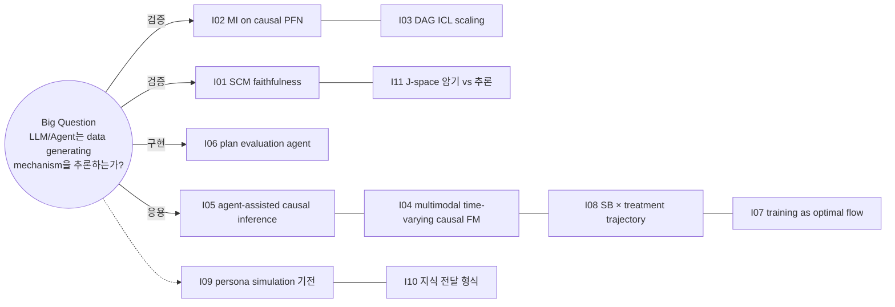

# 연구 아이디어

상태: `seed`(질문만 있음) → `exploring`(조사 중) → `draft`(실험 설계 있음) → `active`(진행 중) / `parked`(보류)

새 아이디어는 `templates/idea.md`를 복사해 `I##-짧은이름.md`로 만듭니다. 에이전트가 제안한 아이디어는 `proposed_by: agent`로 표시됩니다.

<!-- auto:start -->
| ID | 아이디어 | 주제 | 상태 |
|---|---|---|---|
| I01 | [LLM 내부는 프롬프트의 인과 그래프를 충실하게 구현하는가 (SCM faithfulness)](I01-scm-faithfulness-in-llm-internals.md) | mech-interp, causality | draft |
| I02 | [PFN 기반 인과 foundation model은 정말 내부에서 인과 그래프를 찾는가](I02-mi-on-causal-pfn.md) | causality, mech-interp | seed |
| I03 | [In-context learning만으로 복잡한 DAG 구조를 추론할 수 있는가](I03-complex-dag-in-context-learning.md) | causality, mech-interp | seed |
| I05 | [Agent가 돕는 인과추론: DAG 탐색과 sensitivity analysis](I05-agent-assisted-causal-inference.md) | causality, agentic-ai | seed |
| I06 | [Plan evaluation: 순차 action의 인과효과를 추정하는 agent](I06-plan-evaluation-for-causal-agents.md) | causality, agentic-ai | seed |
| I07 | [학습 과정을 optimal flow로: 효율적인 generative model 학습](I07-training-as-optimal-flow.md) | generative-models | seed |
| I08 | [Schrödinger Bridge × Causality: treatment에 따른 trajectory 모델링](I08-treatment-conditioned-trajectory-sb.md) | generative-models, causality | seed |
| I09 | [Persona simulation의 내부 기전: 어떤 입력이 high-fidelity를 만드는가](I09-persona-simulation-mechanism.md) | agentic-ai, mech-interp | seed |
| I10 | [작업 지식을 어떤 형식으로 주면 agent의 실무 능력이 오르는가](I10-knowledge-transfer-format-for-agents.md) | agentic-ai | seed |
| I11 | [J-space로 '암기한 답'과 '추론한 답'을 구분할 수 있는가](I11-j-space-memorization-vs-reasoning.md) | mech-interp | seed |
| I04 | [Multimodal time-varying causal effect estimation foundation model (Agent)](I04-multimodal-time-varying-causal-fm.md) | causality, agentic-ai | parked |

*마지막 갱신: 2026-11-23*
<!-- auto:end -->

## 아이디어 지도

